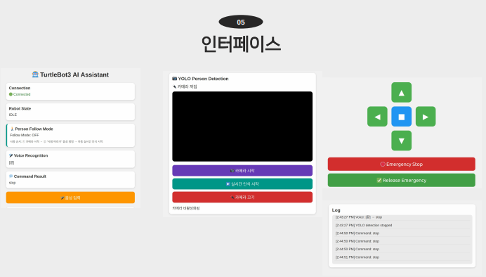

# 🤖 AI 음성 명령 및 비전 기반 터틀봇(TurtleBot3) 제어 시스템 (말해봇)

- **기간**: 2026.07.06 ~ 2026.07.10 (5일간)
- **과정명**: AX로보틱스 자율주행 로봇 개발(중급) 몰입형 과정 (5조 말해봇)
- **개발 환경**: Linux (Ubuntu 22.04 LTS), ROS 2 (Humble), FastAPI, WebSocket, Cloudflare Tunnel
- **사용 언어/도구**: JavaScript (ES6+), HTML5/CSS3, Python, TurtleBot3 Burger, YOLOv11, Whisper.cpp
- **담당 역할**: **Web Frontend 구축, 스마트폰 미디어 스트리밍 파이프라인 설계 및 외부망 웹 터널링 구축**

---

## 📌 프로젝트 개요

기존의 단순 조이스틱이나 터미널 기반 로봇 제어 방식에서 벗어나, **스마트폰 웹 브라우저를 통해 실시간 음성 명령(STT) 및 비전 기반 사람 추적 자율 주행(YOLOv11)으로 TurtleBot3를 원격 제어하는 AI 관제 통합 시스템**을 구축했습니다.

---

## 🛠️ 박상욱 (Web Frontend / Media Streaming) 핵심 구현 및 기여 내용

### 1. 크로스 브라우징 지원 모바일 웹 관제 UI 구현 (`index.html`, `style.css`)
- 스마트폰 브라우저에 최적화된 반응형 웹 인터페이스 및 컨트롤 패드(십자 방향키, Emergency Stop) 설계
- WebSocket 연결 상태(`Connection`), 로봇 동작 상태(`Robot State`), AI 음성 인식 결과 로그를 실시간 렌더링하는 대시보드 카드 UI 구축

### 2. 고성능 비디오 프레임 스트리밍 및 최적화 (`script.js`)
- `navigator.mediaDevices.getUserMedia` API를 바인딩하여 스마트폰 카메라 영상 스트림 확보
- 서버 추론 병목 현상 해결을 위해 Canvas 오프스크린 리사이징 기법을 적용하여 **비디오 프레임을 320px 규격으로 스케일 다운 및 JPEG 품질 55% 압축 적용**
- 백엔드(`/detect` POST API)로 프레임을 전달하여 YOLOv11 사람 탐지 Latency를 100ms 이내로 제어

### 3. MediaRecorder API 기반 모바일 오디오 캡처 파이프라인
- 모바일 마이크 음성을 `audio/webm` 데이터 버퍼로 실시간 녹음 및 백엔드 폼데이터 전송 로직 작성
- 캡처된 음성이 백엔드의 `whisper.cpp` 온디바이스 STT 엔진으로 전달되어 로봇 동작 커맨드로 변환되도록 연동

### 4. W3C 웹 보안 규격 대응 및 보안 터널링 구축 (`Cloudflare Tunnel`)
- 초기 `ngrok` 사용 시 비보안 프로토콜(HTTP) 접속으로 인해 모바일 브라우저의 마이크/카메라 접근 권한이 차단되는 결함 발견
- SSL 자격 증명이 포함된 **Cloudflare Tunnel (Quick Tunnel Mode)**로 원격망 인프라를 전격 교체하여 HTTPS/WSS 보안 프로토콜 우회 접속 환경 구축 완료

---

## ⚙️ 전체 시스템 아키텍처 (E2E Data Flow)

```text
[스마트폰 브라우저 UI (JS/HTML)] 
   │
   ├─ 1. 320px 리사이징 JPEG 프레임 / WebM 오디오 버퍼 전송 (HTTPS)
   ▼
[Cloudflare Tunnel (보안 터널링)]
   │
   ▼
[FastAPI 관제 서버 (server.py)]
   ├─► AI 엔진 1: Whisper.cpp (WAV 변환 및 한국어 온디바이스 STT)
   ├─► AI 엔진 2: Ultralytics YOLOv11 (인간 탐지 및 조향 비율 계산)
   │
   ▼
[MessageRouter (상호배제 Threading Lock 보장)]
   │
   ▼
[ROS 2 WebControlNode (ros_node.py)] ──(10Hz)──► /cmd_vel (geometry_msgs/Twist)
   │
   ▼
[TurtleBot3 Burger / OpenCR 하드웨어] (WiFi 무선 주행 구동)


🎯 주요 성과 및 핵심 트러블슈팅
트러블슈팅 1: 모바일 카메라/마이크 Permission Denied 에러 해결

원인: W3C 웹 표준 보안 정책으로 HTTP 환경에서 미디어 장치 접근이 차단됨.

해결: Cloudflare Tunnel 인프라를도입하여 SSL 자격 인증 주소(https://*.trycloudflare.com)를 부여받아 권한 검증을 완벽히 통과함.

트러블슈팅 2: 비전 추적 제어 패킷 밀림 및 영상 지연 현상 해결

원인: 스마트폰의 고해상도 비디오 프레임이 그대로 전송되어 백엔드 I/O 병목 및 YOLO 연산 적체 발생.

해결: 프론트엔드에서 캔버스 리사이징(320px) 및 JPEG 품질 55% 압축 스트리밍 전송 방식을 적용하여 실시간 반응 속도를 100ms 이내로 단축.

# 전체 아키텍처 흐름


# 시스템 아키텍처 다이어그램


# 인터페이스




